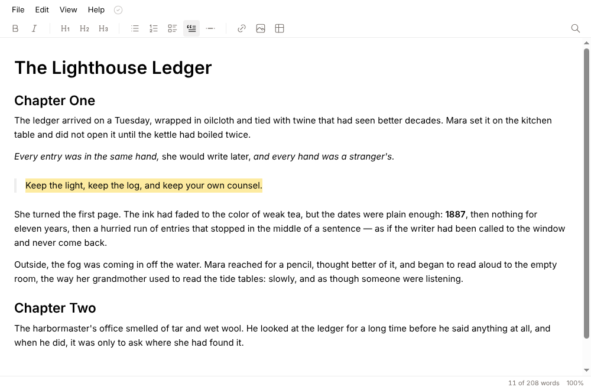

# PicoMarQ 1.3.4

**Website:** https://crotalus65.github.io/PicoMarq/ — what the program is, screenshots, and the download.

A Markdown editor for writers of prose, for Windows 10 and 11 (64-bit). You see formatted text as you type, and your work is saved as a plain `.md` file that any other program can read. It has a spelling checker, a live word count, smart quotes and dashes, Find and Replace, and themes, and it leaves out the file trees, tags, code tools and AI that most Markdown editors are built around.



## Download

**[Download the latest release](https://github.com/Crotalus65/PicoMarq/releases/latest)** and pick `PicoMarQ-Windows-x64-<version>.zip`. The archive is about 156 MB because it carries its own runtime; nothing else needs to be installed.

1. Extract the whole archive to a folder you can write to.
2. Open the extracted `PicoMarQ` folder and run `PicoMarQ.exe`.
3. The program is not code-signed, so Windows SmartScreen may show "Windows protected your PC" the first time. Choose **More info**, then **Run anyway**.

Each release page lists SHA-256 checksums and offers the matching source archive. `START-HERE.txt` in the download explains what is new and how to update; [docs/KEYBOARD-SHORTCUTS.md](docs/KEYBOARD-SHORTCUTS.md) lists every shortcut.

## What it does

- **Two views of one file.** Write in the formatted view; `Ctrl+Shift+M` shows the Markdown source. Headings, italics, bold, quotations, lists, task lists, links, images, tables, math and diagrams.
- **Spelling** in US English, for the whole document, including text you open or paste. Right-click a marked word for suggestions, **Ignore All** (this document, until it is closed), or **Add to Dictionary**. **Settings > Spelling** clears the words you added.
- **Word count** at the bottom right, live. With text selected it reads "56 of 1,234 words".
- **Smart typography**: curly quotes, em dashes from two hyphens, ellipses from three periods, as you type. Backspace takes the change back; **Edit > Apply Smart Typography** converts an existing document.
- **Your page**: Light or Dark, installed fonts, point size 12–24, colors for headings, bold and italic, page width, zoom. Save a look as a theme file and load it elsewhere.
- **One window per document**, with drafts recovered after an unexpected shutdown, the previous session restored at startup (or a new one, if you prefer), and a warning before overwriting a file another program changed. Saving is manual (`Ctrl+S`).

## What it does not do

No notes library, folders or tags; no cloud or sync; no AI; no export to Word or PDF. Spelling is US English only. Windows only.

## Where it comes from

PicoMarQ is built on [Scratch](https://github.com/erictli/scratch), a Markdown note-taking app by Eric Li and contributors, at upstream commit `9126a5adf78abbabd111302ca0b659ca9278d43a`. It keeps Scratch's editor (React, TipTap) and reshapes it for writers rather than note-takers, with an Electron desktop shell in place of Tauri. If you want a notes library, links between notes, AI editing, Git sync, or a Mac or Linux version, use Scratch itself. Scratch's own README is kept as [UPSTREAM-README.md](UPSTREAM-README.md).

MIT License, as Scratch: see [LICENSE](LICENSE). Notices for the libraries included are in [THIRD-PARTY-NOTICES.txt](THIRD-PARTY-NOTICES.txt).

## Building from source

Node 22 or newer and npm:

```sh
npm ci
node node_modules/electron/install.js
npm run build
npm start
```

`npm run build` compiles the renderer into `dist/` (TypeScript, Vite); the main process is in `desktop/`. `npm test` runs the unit tests; the checks that drive the real app are listed in [VALIDATION.md](VALIDATION.md) and need a display (Xvfb on Linux). Releases are assembled from the previous release's Windows package by `scripts/repack-windows-from-*.py`, which replaces the application files and updates the version information of the executable; `npm run package:windows` builds a package from Electron's official release instead.

Tailwind reads every text file in the folder when it compiles the stylesheet, including the `history` patch files and the compiled program of the previous build in `dist/`; keep both in place if you want a byte-identical `dist/`. Started without a `dist/` folder, the first build gives a stylesheet about 12 kB smaller (95 rules that nothing in the program uses are left out); a second build gives the released one.

## History

Version 1.3.4 moves to a newer release of the engine (Electron 44.11.5, with the security fixes since 44.6.0); the program itself is unchanged. Version 1.3.3 stops Undo from emptying a document, keeps the red spelling lines in long paragraphs, makes Find treat what is typed and what Smart Typography makes of it as the same, lets Replace All replace more than 500 matches, and no longer loads pictures from other computers' shared folders. Version 1.3.2 made Find and Replace get along with the spelling checker: Find's highlights no longer take the red lines away from the paragraphs they are in, and text put in by Replace is checked. Version 1.3.1 added Ignore All, Clear Custom Dictionary and Help > About.

What each version changed, and why things are built the way they are: [docs/HISTORY-AND-DESIGN.md](docs/HISTORY-AND-DESIGN.md) and the patches in [history/](history/). The validation of the current version is in [VALIDATION.md](VALIDATION.md).
